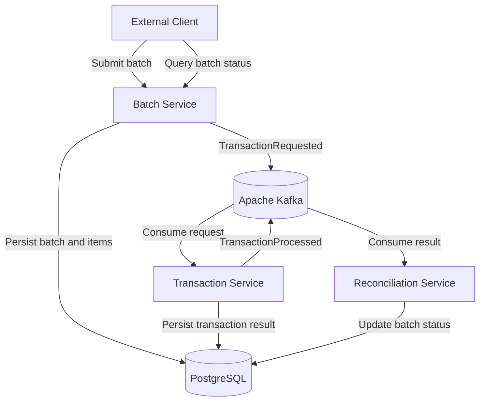

# Architecture — Financial Processing Platform

## 1. Overview

The Financial Processing Platform is an event-driven system designed to ingest, process, and reconcile high-volume financial transaction batches.

The architecture separates batch management, transaction execution, and reconciliation into independently deployable services.

The system uses asynchronous communication through Apache Kafka and relational persistence through PostgreSQL.

The initial implementation simulates financial operations. It does not connect to real banking systems or execute actual financial transfers.

## 2. Architectural Goals

The architecture is designed to address the following challenges:

- Processing large transaction batches without blocking API requests.
- Supporting asynchronous execution.
- Preventing duplicate business effects.
- Handling transient failures and message redelivery.
- Controlling concurrent processing of related accounts.
- Tracking transaction lifecycle and processing results.
- Reconciling batch totals and individual transaction outcomes.

## 3. High-Level Architecture

Each service owns its business responsibilities and data access boundaries. The initial implementation may use a shared PostgreSQL server for local development, while maintaining logical ownership of each service's data.

## 4. Services and Responsibilities

### 4.1 Batch Service

Responsible for batch ingestion and lifecycle management.

Responsibilities:

- Expose REST endpoints for batch submission.
- Validate incoming batch requests.
- Register batch metadata.
- Persist transaction items.
- Publish transaction processing requests.
- Expose batch status and processing summaries.

Potential API endpoints:

| Method | Endpoint | Description |
|---|---|---|
| POST | `/api/v1/batches` | Submit a transaction batch |
| GET | `/api/v1/batches/{batchId}` | Retrieve batch details |
| GET | `/api/v1/batches/{batchId}/summary` | Retrieve processing summary |

### 4.2 Transaction Service

Responsible for processing individual transactions.

Responsibilities:

- Consume transaction requests from Kafka.
- Validate transaction business rules.
- Enforce idempotency.
- Simulate transaction execution.
- Persist transaction outcomes.
- Publish processing results.
- Handle retries and unrecoverable failures.

The transaction processor will simulate an account debit or payment operation. No real financial operation will be performed.

### 4.3 Reconciliation Service

Responsible for consolidating transaction results and reconciling batches.

Responsibilities:

- Consume transaction processing results.
- Update transaction and batch processing summaries.
- Compare expected and processed totals.
- Identify missing or inconsistent results.
- Mark batches as completed, completed with errors, or requiring investigation.

## 5. Event-Driven Communication

Apache Kafka is the asynchronous communication backbone.

Initial event contracts:

| Event | Producer | Consumer |
|---|---|---|
| `TransactionRequested` | Batch Service | Transaction Service |
| `TransactionProcessed` | Transaction Service | Reconciliation Service |

Events should carry identifiers and metadata required for tracing and processing.

Recommended message headers:

| Header | Purpose |
|---|---|
| `x-correlation-id` | Identifies the overall business journey |
| `x-message-id` | Identifies an individual message |
| `x-causation-id` | Identifies the message or event that caused the current event |

A new message receives its own message identifier. The correlation identifier remains consistent across the business journey, while the causation identifier links events to their direct cause.

## 6. Idempotency and Delivery Semantics

Kafka consumers must assume that a message can be delivered more than once.

The platform will use at-least-once delivery combined with idempotent business processing.

The idempotency mechanism will:

1. Identify the business operation using a stable transaction identifier.
2. Enforce uniqueness through a database constraint.
3. Prevent duplicate business effects.
4. Return or preserve the previously recorded result when a duplicate is received.

The system will not claim exactly-once processing across all services.

Database transactions, event publication, and Kafka offset management must be designed carefully to avoid losing business events.

The transactional outbox pattern will be evaluated when implementing reliable event publication.

## 7. Retry and Dead Letter Queue

Transient errors should be retried using a controlled retry policy.

The design will include:

- A configurable retry limit.
- Backoff between attempts.
- Error classification.
- Dead Letter Queue for messages that cannot be processed.
- Sufficient metadata to investigate and replay failed messages safely.

Permanent business validation failures should not be retried indefinitely.

## 8. Concurrency Control

Transactions involving the same account may require ordering or mutual exclusion.

The platform will define a business key for account-level concurrency, such as:

`agencyId + accountId`

The implementation must ensure that concurrent processing does not produce conflicting business effects.

Kafka partitioning and database constraints will be evaluated together. Kafka partitioning alone is not considered sufficient protection against every possible concurrency scenario.

## 9. Persistence

PostgreSQL is the primary relational database.

It will store:

- Batch metadata.
- Transaction records.
- Processing status.
- Idempotency information.
- Reconciliation results.

Schema migrations will be managed through a migration tool.

Each service will own its data access and business rules. A shared PostgreSQL instance may be used for local development without making the services share business logic or persistence responsibilities.

## 10. Observability

The platform will progressively introduce:

- Spring Boot Actuator health endpoints.
- Structured application logs.
- Correlation identifiers.
- Processing counters and latency metrics.
- Distributed tracing.

The goal is to make it possible to follow a transaction from batch submission through processing and reconciliation.

## 11. Testing Strategy

The testing strategy will include:

- Unit tests for business rules.
- Spring Boot integration tests.
- Repository tests against PostgreSQL.
- Kafka integration tests.
- Idempotency and duplicate delivery tests.
- Failure and retry scenarios.
- Concurrency tests.

Testcontainers will be used to run infrastructure dependencies during integration testing.

## 12. Deployment and Local Development

Docker Compose will provide the local infrastructure required for development.

The initial environment will prioritize a lightweight configuration suitable for a developer workstation with limited memory.

Services and infrastructure will be introduced incrementally.

## 13. Architecture Evolution

The implementation will follow these milestones:

1. Spring Boot application foundation.
2. API contracts and domain model.
3. PostgreSQL persistence and schema migrations.
4. Batch ingestion.
5. Kafka event publication and consumption.
6. Idempotent transaction processing.
7. Retry and Dead Letter Queue.
8. Reconciliation workflow.
9. Observability and automated integration tests.
10. Performance testing and architecture refinement.

Architectural decisions will be documented as the implementation evolves.